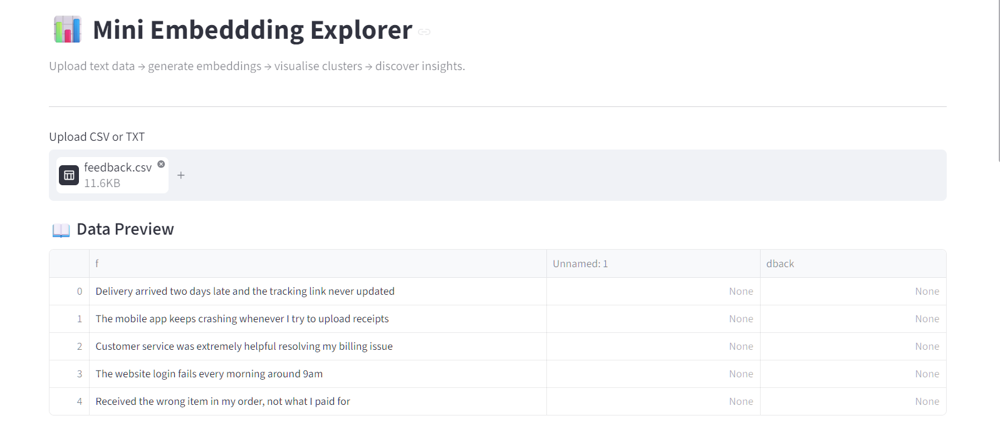
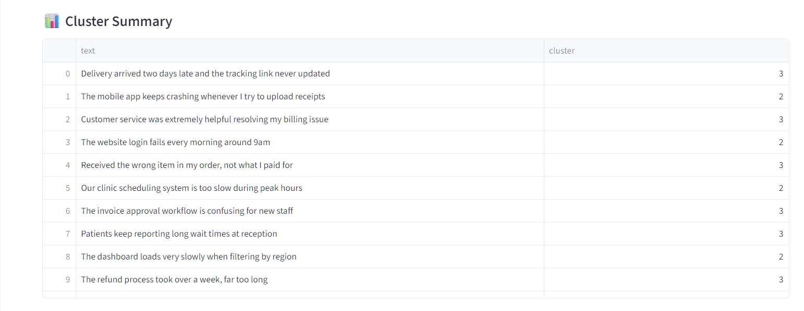

# 📊 Mini Embedding Explorer


A lightweight, business‑ready analytics tool that transforms raw text into visual insights.  
Upload customer feedback, support tickets, policies, CVs, or any text dataset — the app generates embeddings, reduces them to 2D, clusters them, and reveals hidden patterns.

Perfect for SMEs, councils, charities, and teams that need fast, text understanding without complex infrastructure.

---

## 📑 Table of Contents

- [Why This Project Was Built](#-why-this-project-was-built)
- [Screenshots](#-screenshots)
- [Features](#-features)
- [Real-World Use Cases](#-realworld-use-cases)
- [Installation](#-installation)
- [Run the App](#️-run-the-app)
- [Project Structure](#-project-structure)
- [How It Works](#-how-it-works)
- [Example Workflow](#-example-workflow)
- [Example Use Case](#-example-use-case-customer-feedback)
- [Why This Project Was Built](#-why-this-project-was-built)
- [Testing](#-testing)
- [Roadmap Features](#️-roadmap-features)

---

## 🧠 Why This Project Was Built

- Explore large text datasets without complex AI infrastructure.
- Visualise embeddings, clusters, and relationships in a simple interface.
- Make modern NLP techniques more accessible to non-technical users.
- Quickly uncover themes and patterns in text data.

---

## 📸 Screenshots

<details>
    <summary>click here</summary>

- Dashboard and CSV preview


- Scatter graph of embeddings


- Cluster summary of the CSV data


</details>

---

## 🚀 Features

- Upload **CSV or TXT** files  
- Choose an **embedding model** (MiniLM by default)  
- Automatic **dimensionality reduction** (PCA or UMAP)  
- **KMeans clustering** with adjustable cluster count  
- Interactive **2D scatter plot**  
- Hover to view original text  
- Download clustered results as CSV  
- Zero configuration — runs locally or on Streamlit Cloud

---

## 🧠 Real‑World Use Cases

<details>
    <summary>click here</summary>

This tool is intentionally small but delivers real business value:

- **Customer Feedback Clustering** — identify themes in reviews and surveys  
- **Support Ticket Triage** — group recurring issues and detect outliers  
- **Document Similarity** — map policies, reports, and internal knowledge  
- **Fraud Pattern Discovery** — spot repeated scam wording or anomalies  
- **HR & Recruitment Insights** — compare CVs and job descriptions  
- **SEO Topic Mapping** — visualise content clusters and gaps  

</details>

---

## 📦 Installation

### Clone the Repository

```bash
git clone https://github.com/reory/mini_embedding_explorer.git
cd mini_embedding_explorer
```

```bash
uv sync
```

---

## ▶️ Run the App

```bash
streamlit run app.py
```

---

## 📁 Project Structure

```
mini_embedding_explorer/
│
├── app.py                 # Streamlit UI
├── screenshots/
├── embeddings.py          # Embedding + clustering engine
├── tests/
|    ├── test_clustering.py
|    ├── test_embeddings.py
|    └── test_property_based.py
├── pyproject.toml         # Dependencies
├── README.md              # Project documentation
└── examples/
    └── feedback.csv
```

---

## 🧩 How It Works

<details>
    <summary>click here</summary>

- **Embeddings** 
Text is converted into numerical vectors using a SentenceTransformer model.

- **Dimensionality Reduction**
High‑dimensional vectors are compressed into 2D using PCA or UMAP.

- **Clustering** 
KMeans groups similar texts together.

- **Visualisation** 
The 2D points are plotted so humans can see patterns instantly.

</details>

---

## 📊 Example Workflow

<details>
    <summary>click here</summary>

- Upload a CSV of customer comments

- Select the text column

- Choose PCA or UMAP

- Pick number of clusters

- Generate embeddings

- Explore clusters visually

- Download results

</details>

---

## 📝 Example Use Case: Customer Feedback

<details>
    <summary>click here</summary>

A business uploads:

feedback.csv
- "Delivery was late again"
- "Website login keeps failing"
- "Customer service was excellent"
- "Refund process is confusing"

The tool reveals clusters like:

- Delivery issues

- Website bugs

- Positive service comments

- Refund complaints

- This helps teams prioritise improvements.

</details>

---

## 🧪 Testing

- Run the test suite

```bash
uv run -m pytest
```

---

## 🛣️ Roadmap Features

- [ ] **Semantic Search Engine** – Search datasets using natural language queries.
- [ ] **Topic Labelling** – Automatically assign cluster labels.
- [ ] **Interactive Cluster Editing** – Merge, rename, or split clusters directly in the UI.
- [ ] **Advanced Embedding Models** – Add support for larger or domain-specific models.
- [ ] **Lightweight NLP Mode** – Add TF-IDF vectorisation as a lightweight alternative to transformer embeddings.

---

* **Built by Roy Peters** 😁
[](https://www.linkedin.com/in/roy-p-74980b382/)
